# OptuML Benchmark Results

Default scikit-learn hyperparameters vs. OptuML optimization (20 quick / 50 full trials).

- `CV` = mean inner cross-validation score on the training set (for OptuML this is the best trial, so it is optimistically biased); `Test` = score on the held-out test set.
- `ΔCV` / `ΔTest` = full-budget OptuML minus default (positive = optimization helped).
- `90% @` = trial at which the best-so-far CV score first reached 90% of its final gain.

## Summary

| Dataset | Task | Algorithms | Improved (test) | Worse (test) | Median ΔTest | Best default (test) | Best OptuML (test) |
|---------|------|:----------:|:---------------:|:------------:|:------------:|:-------------------:|:------------------:|
| Iris | classification | 25 | 11 | 2 | +0.0000 | 1.0000 (QDA) | 1.0000 (KNeighborsClassifier) |
| Wine | classification | 25 | 7 | 6 | +0.0000 | 1.0000 (RandomForestClassifier) | 1.0000 (KNeighborsClassifier) |
| Breast Cancer | classification | 25 | 10 | 5 | +0.0000 | 0.9825 (SVC) | 0.9825 (SVC) |
| Synthetic 3-class | classification | 25 | 10 | 9 | +0.0000 | 0.7500 (RandomForestClassifier) | 0.7500 (GradientBoostingClassifier) |
| Diabetes | regression | 26 | 20 | 5 | +0.0129 | 0.5231 (SVR) | 0.5270 (GaussianProcessRegressor) |
| Friedman1 | regression | 26 | 18 | 6 | +0.0039 | 0.9071 (CatBoostRegressor) | 0.9210 (CatBoostRegressor) |

## Iris (Classification) — accuracy

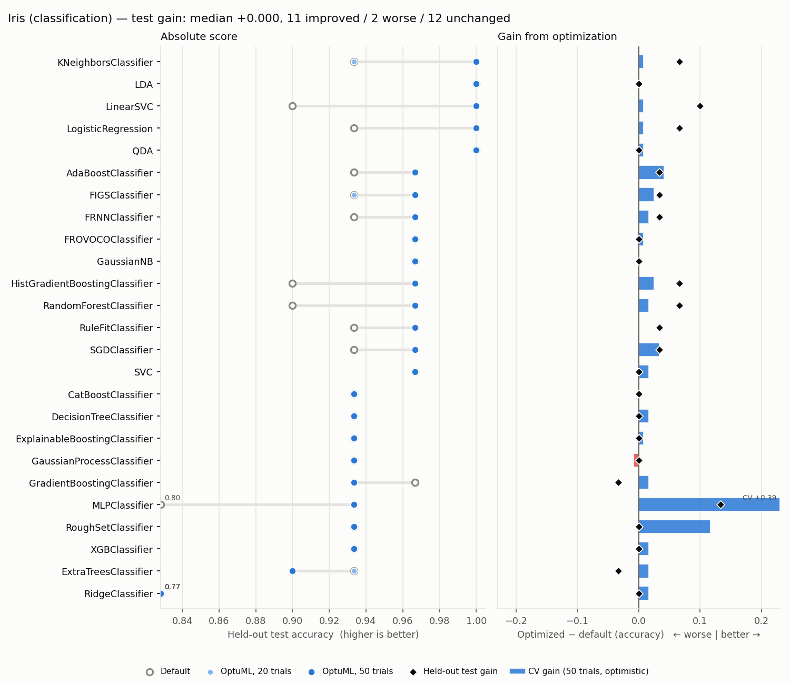

| Algorithm | Default CV | Default Test | Quick Test | Full CV | Full Test | ΔCV | ΔTest | 90% @ | Time (s) |
|-----------|:----------:|:------------:|:----------:|:-------:|:---------:|:---:|:-----:|:-----:|:--------:|
| KNeighborsClassifier | 0.9583 | 0.9333 | 0.9333 | 0.9667 | 1.0000 | +0.0083 | +0.0667 | 28 | 1.1 |
| QDA | 0.9667 | 1.0000 | 1.0000 | 0.9750 | 1.0000 | +0.0083 | +0.0000 | 13 | 3.7 |
| LDA | 0.9750 | 1.0000 | 1.0000 | 0.9750 | 1.0000 | +0.0000 | +0.0000 | --- | 5.1 |
| LinearSVC | 0.9417 | 0.9000 | 1.0000 | 0.9500 | 1.0000 | +0.0083 | +0.1000 | 9 | 1.3 |
| LogisticRegression | 0.9583 | 0.9333 | 1.0000 | 0.9667 | 1.0000 | +0.0083 | +0.0667 | 11 | 1.9 |
| SVC | 0.9667 | 0.9667 | 0.9667 | 0.9833 | 0.9667 | +0.0167 | +0.0000 | 30 | 1.1 |
| RandomForestClassifier | 0.9500 | 0.9000 | 0.9667 | 0.9667 | 0.9667 | +0.0167 | +0.0667 | 1 | 26.9 |
| AdaBoostClassifier | 0.9333 | 0.9333 | 0.9667 | 0.9750 | 0.9667 | +0.0417 | +0.0333 | 14 | 44.9 |
| HistGradientBoostingClassifier | 0.9500 | 0.9000 | 0.9667 | 0.9750 | 0.9667 | +0.0250 | +0.0667 | 28 | 52.4 |
| GaussianNB | 0.9500 | 0.9667 | 0.9667 | 0.9500 | 0.9667 | +0.0000 | +0.0000 | --- | 4.0 |
| SGDClassifier | 0.9250 | 0.9333 | 0.9667 | 0.9583 | 0.9667 | +0.0333 | +0.0333 | 7 | 1.5 |
| FRNNClassifier | 0.9583 | 0.9333 | 0.9667 | 0.9750 | 0.9667 | +0.0167 | +0.0333 | 3 | 1.6 |
| FROVOCOClassifier | 0.9583 | 0.9667 | 0.9667 | 0.9667 | 0.9667 | +0.0083 | +0.0000 | 5 | 2.8 |
| RuleFitClassifier | 0.9583 | 0.9333 | 0.9667 | 0.9583 | 0.9667 | +0.0000 | +0.0333 | --- | 152.1 |
| FIGSClassifier | 0.9417 | 0.9333 | 0.9333 | 0.9667 | 0.9667 | +0.0250 | +0.0333 | 13 | 3.2 |
| GradientBoostingClassifier | 0.9500 | 0.9667 | 0.9333 | 0.9667 | 0.9333 | +0.0167 | -0.0333 | 4 | 81.4 |
| MLPClassifier | 0.5750 | 0.8000 | 0.9333 | 0.9667 | 0.9333 | +0.3917 | +0.1333 | 2 | 111.5 |
| GaussianProcessClassifier | 0.9750 | 0.9333 | 0.9333 | 0.9667 | 0.9333 | -0.0083 | +0.0000 | --- | 107.1 |
| DecisionTreeClassifier | 0.9500 | 0.9333 | 0.9333 | 0.9667 | 0.9333 | +0.0167 | +0.0000 | 1 | 0.7 |
| RoughSetClassifier | 0.8417 | 0.9333 | 0.9333 | 0.9583 | 0.9333 | +0.1167 | +0.0000 | 11 | 1.6 |
| CatBoostClassifier | 0.9583 | 0.9333 | 0.9333 | 0.9583 | 0.9333 | +0.0000 | +0.0000 | --- | 58.8 |
| XGBClassifier | 0.9500 | 0.9333 | 0.9333 | 0.9667 | 0.9333 | +0.0167 | +0.0000 | 35 | 95.7 |
| ExplainableBoostingClassifier | 0.9500 | 0.9333 | 0.9333 | 0.9583 | 0.9333 | +0.0083 | +0.0000 | 1 | 91.1 |
| ExtraTreesClassifier | 0.9500 | 0.9333 | 0.9333 | 0.9667 | 0.9000 | +0.0167 | -0.0333 | 22 | 13.2 |
| RidgeClassifier | 0.8417 | 0.7667 | 0.7667 | 0.8583 | 0.7667 | +0.0167 | +0.0000 | 1 | 1.2 |

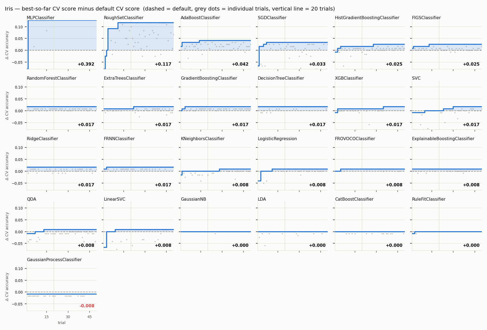

## Wine (Classification) — accuracy

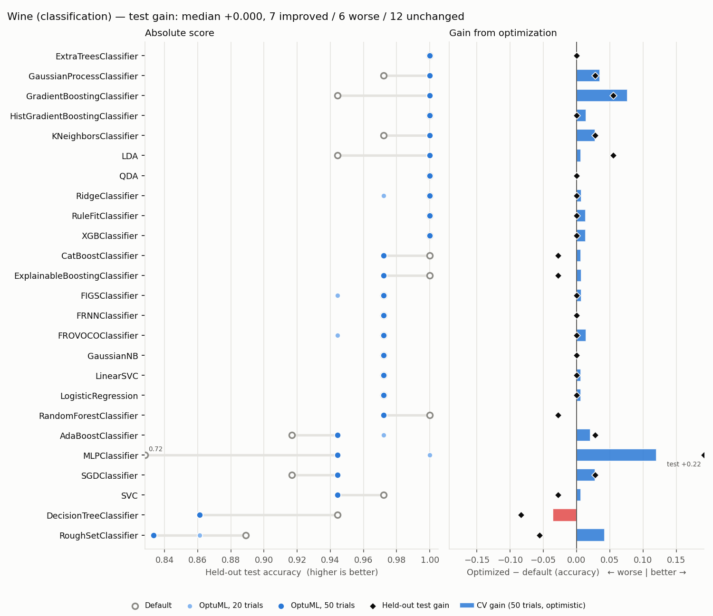

| Algorithm | Default CV | Default Test | Quick Test | Full CV | Full Test | ΔCV | ΔTest | 90% @ | Time (s) |
|-----------|:----------:|:------------:|:----------:|:-------:|:---------:|:---:|:-----:|:-----:|:--------:|
| KNeighborsClassifier | 0.9507 | 0.9722 | 1.0000 | 0.9788 | 1.0000 | +0.0281 | +0.0278 | 5 | 1.1 |
| ExtraTreesClassifier | 0.9860 | 1.0000 | 1.0000 | 0.9860 | 1.0000 | +0.0000 | +0.0000 | --- | 19.1 |
| GradientBoostingClassifier | 0.9236 | 0.9444 | 1.0000 | 1.0000 | 1.0000 | +0.0764 | +0.0556 | 9 | 93.4 |
| HistGradientBoostingClassifier | 0.9581 | 1.0000 | 1.0000 | 0.9724 | 1.0000 | +0.0143 | +0.0000 | 4 | 59.4 |
| QDA | 0.9931 | 1.0000 | 1.0000 | 0.9931 | 1.0000 | +0.0000 | +0.0000 | --- | 0.6 |
| LDA | 0.9722 | 0.9444 | 1.0000 | 0.9791 | 1.0000 | +0.0069 | +0.0556 | 4 | 1.2 |
| GaussianProcessClassifier | 0.9438 | 0.9722 | 1.0000 | 0.9793 | 1.0000 | +0.0355 | +0.0278 | 1 | 174.4 |
| RidgeClassifier | 0.9722 | 1.0000 | 0.9722 | 0.9793 | 1.0000 | +0.0071 | +0.0000 | 23 | 1.2 |
| XGBClassifier | 0.9650 | 1.0000 | 1.0000 | 0.9791 | 1.0000 | +0.0140 | +0.0000 | 7 | 101.3 |
| RuleFitClassifier | 0.9581 | 1.0000 | 1.0000 | 0.9722 | 1.0000 | +0.0140 | +0.0000 | 1 | 167.2 |
| RandomForestClassifier | 0.9791 | 1.0000 | 0.9722 | 0.9791 | 0.9722 | +0.0000 | -0.0278 | --- | 30.5 |
| GaussianNB | 0.9722 | 0.9722 | 0.9722 | 0.9722 | 0.9722 | +0.0000 | +0.0000 | --- | 0.6 |
| LinearSVC | 0.9791 | 0.9722 | 0.9722 | 0.9860 | 0.9722 | +0.0069 | +0.0000 | 17 | 1.2 |
| LogisticRegression | 0.9791 | 0.9722 | 0.9722 | 0.9860 | 0.9722 | +0.0069 | +0.0000 | 12 | 3.0 |
| CatBoostClassifier | 0.9722 | 1.0000 | 0.9722 | 0.9791 | 0.9722 | +0.0069 | -0.0278 | 2 | 107.3 |
| FRNNClassifier | 0.9648 | 0.9722 | 0.9722 | 0.9648 | 0.9722 | +0.0000 | +0.0000 | --- | 1.7 |
| FROVOCOClassifier | 0.9648 | 0.9722 | 0.9444 | 0.9791 | 0.9722 | +0.0143 | +0.0000 | 33 | 3.5 |
| ExplainableBoostingClassifier | 0.9650 | 1.0000 | 0.9722 | 0.9722 | 0.9722 | +0.0071 | -0.0278 | 3 | 144.3 |
| FIGSClassifier | 0.9163 | 0.9722 | 0.9444 | 0.9234 | 0.9722 | +0.0071 | +0.0000 | 4 | 4.1 |
| SVC | 0.9862 | 0.9722 | 0.9444 | 0.9931 | 0.9444 | +0.0069 | -0.0278 | 10 | 1.1 |
| AdaBoostClassifier | 0.9441 | 0.9167 | 0.9722 | 0.9648 | 0.9444 | +0.0207 | +0.0278 | 39 | 49.7 |
| MLPClassifier | 0.8727 | 0.7222 | 1.0000 | 0.9931 | 0.9444 | +0.1204 | +0.2222 | 27 | 64.3 |
| SGDClassifier | 0.9719 | 0.9167 | 0.9444 | 1.0000 | 0.9444 | +0.0281 | +0.0278 | 13 | 1.7 |
| DecisionTreeClassifier | 0.9022 | 0.9444 | 0.8611 | 0.8665 | 0.8611 | -0.0357 | -0.0833 | --- | 0.8 |
| RoughSetClassifier | 0.8734 | 0.8889 | 0.8611 | 0.9155 | 0.8333 | +0.0421 | -0.0556 | 50 | 4.7 |

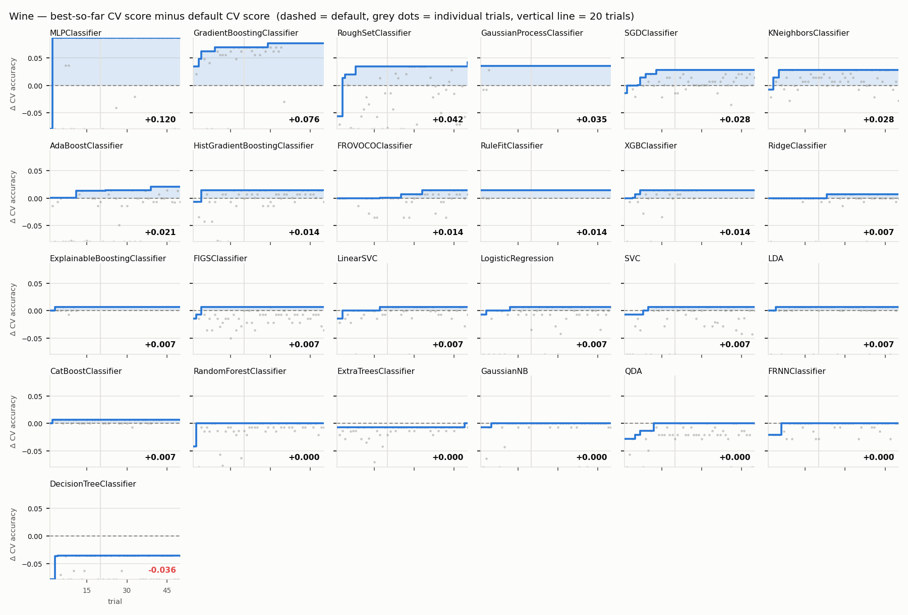

## Breast Cancer (Classification) — accuracy

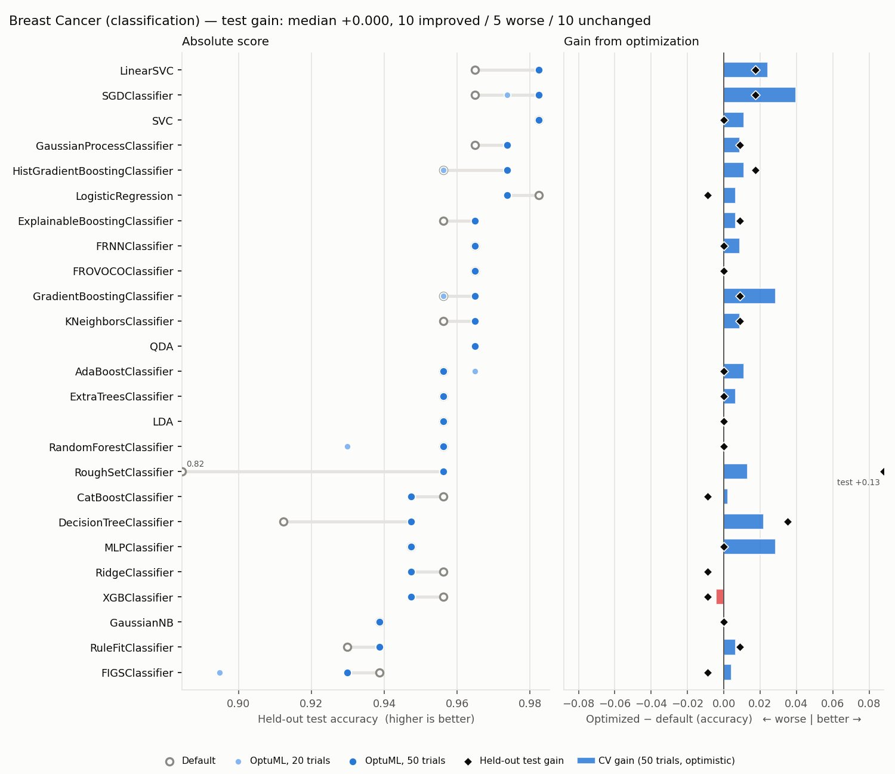

| Algorithm | Default CV | Default Test | Quick Test | Full CV | Full Test | ΔCV | ΔTest | 90% @ | Time (s) |
|-----------|:----------:|:------------:|:----------:|:-------:|:---------:|:---:|:-----:|:-----:|:--------:|
| SVC | 0.9692 | 0.9825 | 0.9825 | 0.9802 | 0.9825 | +0.0110 | +0.0000 | 32 | 1.6 |
| LinearSVC | 0.9604 | 0.9649 | 0.9825 | 0.9846 | 0.9825 | +0.0242 | +0.0175 | 25 | 1.9 |
| SGDClassifier | 0.9451 | 0.9649 | 0.9737 | 0.9846 | 0.9825 | +0.0396 | +0.0175 | 6 | 1.6 |
| HistGradientBoostingClassifier | 0.9626 | 0.9561 | 0.9561 | 0.9736 | 0.9737 | +0.0110 | +0.0175 | 30 | 45.5 |
| GaussianProcessClassifier | 0.9692 | 0.9649 | 0.9737 | 0.9780 | 0.9737 | +0.0088 | +0.0088 | 1 | 165.5 |
| LogisticRegression | 0.9780 | 0.9825 | 0.9737 | 0.9846 | 0.9737 | +0.0066 | -0.0088 | 15 | 5.3 |
| KNeighborsClassifier | 0.9626 | 0.9561 | 0.9649 | 0.9714 | 0.9649 | +0.0088 | +0.0088 | 25 | 1.3 |
| GradientBoostingClassifier | 0.9516 | 0.9561 | 0.9561 | 0.9802 | 0.9649 | +0.0286 | +0.0088 | 13 | 82.6 |
| QDA | --- | --- | 0.9649 | 0.9582 | 0.9649 | --- | --- | --- | 0.7 |
| FRNNClassifier | 0.9670 | 0.9649 | 0.9649 | 0.9758 | 0.9649 | +0.0088 | +0.0000 | 2 | 4.0 |
| FROVOCOClassifier | 0.9451 | 0.9649 | 0.9649 | 0.9451 | 0.9649 | +0.0000 | +0.0000 | --- | 10.1 |
| ExplainableBoostingClassifier | 0.9714 | 0.9561 | 0.9649 | 0.9780 | 0.9649 | +0.0066 | +0.0088 | 4 | 139.6 |
| RandomForestClassifier | 0.9626 | 0.9561 | 0.9298 | 0.9626 | 0.9561 | +0.0000 | +0.0000 | --- | 42.7 |
| ExtraTreesClassifier | 0.9714 | 0.9561 | 0.9561 | 0.9780 | 0.9561 | +0.0066 | +0.0000 | 42 | 30.8 |
| AdaBoostClassifier | 0.9670 | 0.9561 | 0.9649 | 0.9780 | 0.9561 | +0.0110 | +0.0000 | 32 | 62.4 |
| LDA | 0.9604 | 0.9561 | 0.9561 | 0.9604 | 0.9561 | +0.0000 | +0.0000 | --- | 1.0 |
| RoughSetClassifier | 0.9451 | 0.8246 | 0.9561 | 0.9582 | 0.9561 | +0.0132 | +0.1316 | 14 | 17.5 |
| MLPClassifier | 0.9516 | 0.9474 | 0.9474 | 0.9802 | 0.9474 | +0.0286 | +0.0000 | 13 | 37.9 |
| RidgeClassifier | 0.9626 | 0.9561 | 0.9474 | 0.9626 | 0.9474 | +0.0000 | -0.0088 | --- | 1.2 |
| DecisionTreeClassifier | 0.9165 | 0.9123 | 0.9474 | 0.9385 | 0.9474 | +0.0220 | +0.0351 | 19 | 1.1 |
| CatBoostClassifier | 0.9736 | 0.9561 | 0.9474 | 0.9758 | 0.9474 | +0.0022 | -0.0088 | 3 | 156.0 |
| XGBClassifier | 0.9670 | 0.9561 | 0.9474 | 0.9626 | 0.9474 | -0.0044 | -0.0088 | --- | 236.4 |
| GaussianNB | 0.9407 | 0.9386 | 0.9386 | 0.9407 | 0.9386 | +0.0000 | +0.0000 | --- | 0.7 |
| RuleFitClassifier | 0.9538 | 0.9298 | 0.9386 | 0.9604 | 0.9386 | +0.0066 | +0.0088 | 6 | 138.3 |
| FIGSClassifier | 0.9275 | 0.9386 | 0.8947 | 0.9319 | 0.9298 | +0.0044 | -0.0088 | 3 | 20.4 |

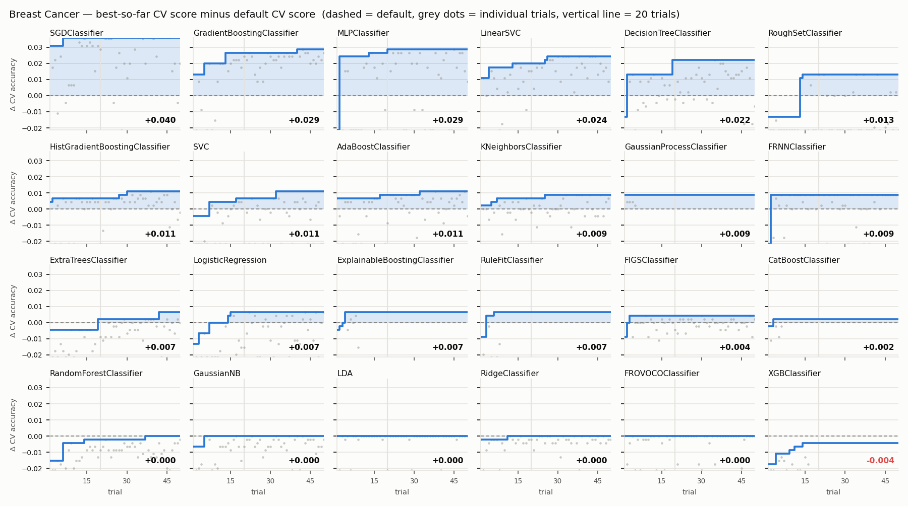

## Synthetic 3-class (Classification) — accuracy

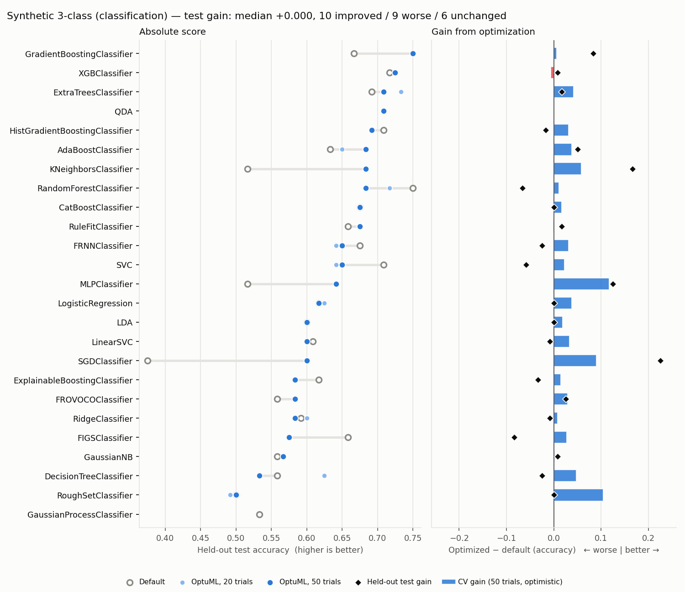

| Algorithm | Default CV | Default Test | Quick Test | Full CV | Full Test | ΔCV | ΔTest | 90% @ | Time (s) |
|-----------|:----------:|:------------:|:----------:|:-------:|:---------:|:---:|:-----:|:-----:|:--------:|
| GradientBoostingClassifier | 0.7250 | 0.6667 | 0.7500 | 0.7312 | 0.7500 | +0.0062 | +0.0833 | 1 | 132.7 |
| XGBClassifier | 0.7188 | 0.7167 | 0.7250 | 0.7125 | 0.7250 | -0.0062 | +0.0083 | --- | 1355.0 |
| ExtraTreesClassifier | 0.7354 | 0.6917 | 0.7333 | 0.7771 | 0.7083 | +0.0417 | +0.0167 | 11 | 59.9 |
| QDA | --- | --- | 0.7083 | 0.7000 | 0.7083 | --- | --- | --- | 1.0 |
| HistGradientBoostingClassifier | 0.7042 | 0.7083 | 0.6917 | 0.7354 | 0.6917 | +0.0313 | -0.0167 | 6 | 125.1 |
| KNeighborsClassifier | 0.6042 | 0.5167 | 0.6833 | 0.6625 | 0.6833 | +0.0583 | +0.1667 | 8 | 3.1 |
| RandomForestClassifier | 0.7479 | 0.7500 | 0.7167 | 0.7583 | 0.6833 | +0.0104 | -0.0667 | 23 | 84.4 |
| AdaBoostClassifier | 0.6208 | 0.6333 | 0.6500 | 0.6583 | 0.6833 | +0.0375 | +0.0500 | 38 | 87.5 |
| CatBoostClassifier | 0.7458 | 0.6750 | 0.6750 | 0.7625 | 0.6750 | +0.0167 | +0.0000 | 5 | 196.2 |
| RuleFitClassifier | 0.7146 | 0.6583 | 0.6750 | 0.7125 | 0.6750 | -0.0021 | +0.0167 | --- | 173.2 |
| SVC | 0.6833 | 0.7083 | 0.6417 | 0.7062 | 0.6500 | +0.0229 | -0.0583 | 50 | 8.0 |
| FRNNClassifier | 0.6792 | 0.6750 | 0.6417 | 0.7104 | 0.6500 | +0.0313 | -0.0250 | 25 | 4.9 |
| MLPClassifier | 0.5563 | 0.5167 | 0.6417 | 0.6729 | 0.6417 | +0.1167 | +0.1250 | 15 | 104.6 |
| LogisticRegression | 0.5708 | 0.6167 | 0.6250 | 0.6083 | 0.6167 | +0.0375 | +0.0000 | 46 | 59.5 |
| LDA | 0.5729 | 0.6000 | 0.6000 | 0.5917 | 0.6000 | +0.0187 | +0.0000 | 37 | 1.3 |
| LinearSVC | 0.5729 | 0.6083 | 0.6000 | 0.6062 | 0.6000 | +0.0333 | -0.0083 | 5 | 52.3 |
| SGDClassifier | 0.5208 | 0.3750 | 0.6000 | 0.6104 | 0.6000 | +0.0896 | +0.2250 | 19 | 16.2 |
| RidgeClassifier | 0.5688 | 0.5917 | 0.6000 | 0.5771 | 0.5833 | +0.0083 | -0.0083 | 22 | 27.7 |
| FROVOCOClassifier | 0.6000 | 0.5583 | 0.5833 | 0.6292 | 0.5833 | +0.0292 | +0.0250 | 12 | 11.4 |
| ExplainableBoostingClassifier | 0.6542 | 0.6167 | 0.5833 | 0.6687 | 0.5833 | +0.0146 | -0.0333 | 4 | 136.3 |
| FIGSClassifier | 0.6542 | 0.6583 | 0.5750 | 0.6813 | 0.5750 | +0.0271 | -0.0833 | 25 | 81.2 |
| GaussianNB | 0.5979 | 0.5583 | 0.5667 | 0.6000 | 0.5667 | +0.0021 | +0.0083 | 13 | 0.9 |
| DecisionTreeClassifier | 0.5875 | 0.5583 | 0.6250 | 0.6354 | 0.5333 | +0.0479 | -0.0250 | 4 | 15.4 |
| RoughSetClassifier | 0.4667 | 0.5000 | 0.4917 | 0.5708 | 0.5000 | +0.1042 | +0.0000 | 39 | 38.8 |
| GaussianProcessClassifier | 0.5896 | 0.5333 | --- | --- | --- | --- | --- | --- | 1.5 |

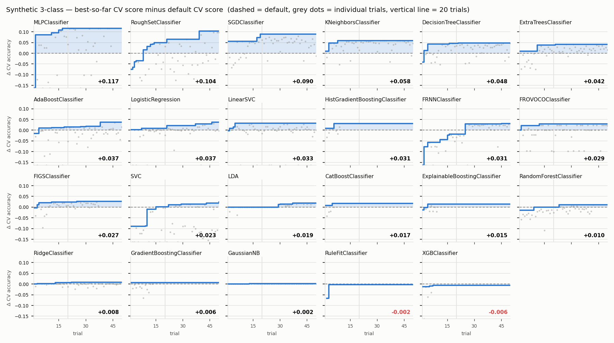

## Diabetes (Regression) — R²

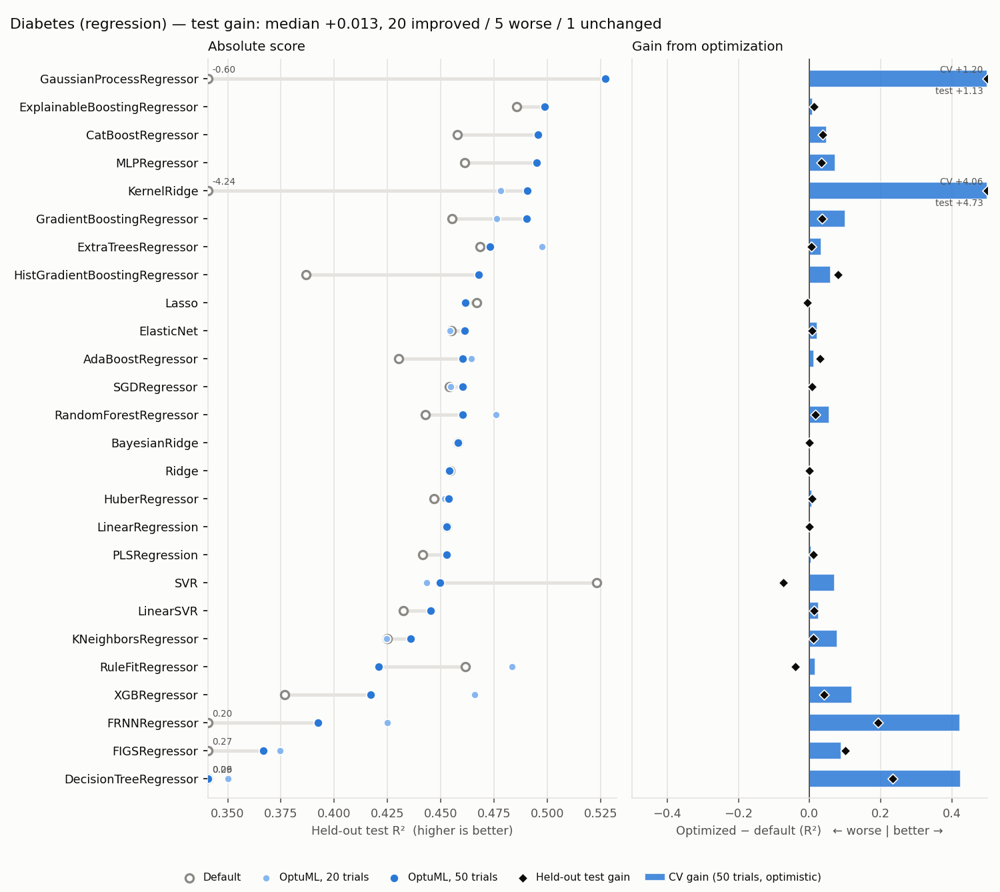

| Algorithm | Default CV | Default Test | Quick Test | Full CV | Full Test | ΔCV | ΔTest | 90% @ | Time (s) |
|-----------|:----------:|:------------:|:----------:|:-------:|:---------:|:---:|:-----:|:-----:|:--------:|
| GaussianProcessRegressor | -0.7457 | -0.5997 | 0.5270 | 0.4546 | 0.5270 | +1.2003 | +1.1267 | 1 | 152.2 |
| ExplainableBoostingRegressor | 0.4726 | 0.4856 | 0.4986 | 0.4825 | 0.4986 | +0.0099 | +0.0130 | 8 | 138.8 |
| CatBoostRegressor | 0.4017 | 0.4578 | 0.4955 | 0.4500 | 0.4955 | +0.0483 | +0.0377 | 15 | 126.8 |
| MLPRegressor | 0.4034 | 0.4612 | 0.4949 | 0.4755 | 0.4949 | +0.0721 | +0.0337 | 10 | 108.6 |
| KernelRidge | -3.5726 | -4.2358 | 0.4781 | 0.4858 | 0.4905 | +4.0584 | +4.7264 | 4 | 17.8 |
| GradientBoostingRegressor | 0.3672 | 0.4550 | 0.4762 | 0.4675 | 0.4904 | +0.1004 | +0.0353 | 29 | 39.3 |
| ExtraTreesRegressor | 0.4290 | 0.4685 | 0.4976 | 0.4625 | 0.4731 | +0.0335 | +0.0046 | 14 | 19.8 |
| HistGradientBoostingRegressor | 0.3712 | 0.3866 | 0.4676 | 0.4315 | 0.4676 | +0.0603 | +0.0810 | 4 | 116.5 |
| Lasso | 0.4808 | 0.4669 | 0.4614 | 0.4813 | 0.4614 | +0.0006 | -0.0054 | 16 | 2.8 |
| ElasticNet | 0.4584 | 0.4548 | 0.4544 | 0.4813 | 0.4610 | +0.0230 | +0.0063 | 1 | 4.4 |
| AdaBoostRegressor | 0.4294 | 0.4301 | 0.4644 | 0.4418 | 0.4603 | +0.0124 | +0.0302 | 42 | 62.8 |
| SGDRegressor | 0.4805 | 0.4540 | 0.4547 | 0.4810 | 0.4603 | +0.0004 | +0.0063 | 29 | 6.2 |
| RandomForestRegressor | 0.3990 | 0.4428 | 0.4758 | 0.4544 | 0.4601 | +0.0555 | +0.0172 | 25 | 58.5 |
| BayesianRidge | 0.4794 | 0.4579 | 0.4579 | 0.4794 | 0.4579 | +0.0000 | -0.0000 | 30 | 6.1 |
| Ridge | 0.4808 | 0.4541 | 0.4542 | 0.4808 | 0.4541 | +0.0000 | -0.0001 | 43 | 0.9 |
| HuberRegressor | 0.4730 | 0.4468 | 0.4517 | 0.4807 | 0.4538 | +0.0077 | +0.0069 | 2 | 10.9 |
| LinearRegression | 0.4804 | 0.4526 | 0.4526 | 0.4804 | 0.4526 | +0.0000 | +0.0000 | --- | 0.0 |
| PLSRegression | 0.4747 | 0.4413 | 0.4526 | 0.4804 | 0.4526 | +0.0056 | +0.0113 | 2 | 3.3 |
| SVR | 0.4139 | 0.5231 | 0.4433 | 0.4844 | 0.4496 | +0.0705 | -0.0735 | 8 | 2.6 |
| LinearSVR | 0.4617 | 0.4324 | 0.4454 | 0.4871 | 0.4452 | +0.0254 | +0.0128 | 26 | 2.9 |
| KNeighborsRegressor | 0.3447 | 0.4248 | 0.4246 | 0.4239 | 0.4359 | +0.0792 | +0.0111 | 14 | 1.1 |
| RuleFitRegressor | 0.3981 | 0.4614 | 0.4834 | 0.4153 | 0.4208 | +0.0172 | -0.0406 | 1 | 162.7 |
| XGBRegressor | 0.2929 | 0.3768 | 0.4658 | 0.4120 | 0.4171 | +0.1192 | +0.0403 | 1 | 465.0 |
| FRNNRegressor | 0.0005 | 0.1988 | 0.4248 | 0.4241 | 0.3924 | +0.4236 | +0.1936 | 1 | 1.6 |
| FIGSRegressor | 0.3159 | 0.2652 | 0.3747 | 0.4056 | 0.3666 | +0.0898 | +0.1015 | 25 | 90.2 |
| DecisionTreeRegressor | -0.1081 | 0.0607 | 0.3502 | 0.3166 | 0.2949 | +0.4247 | +0.2343 | 19 | 3.8 |

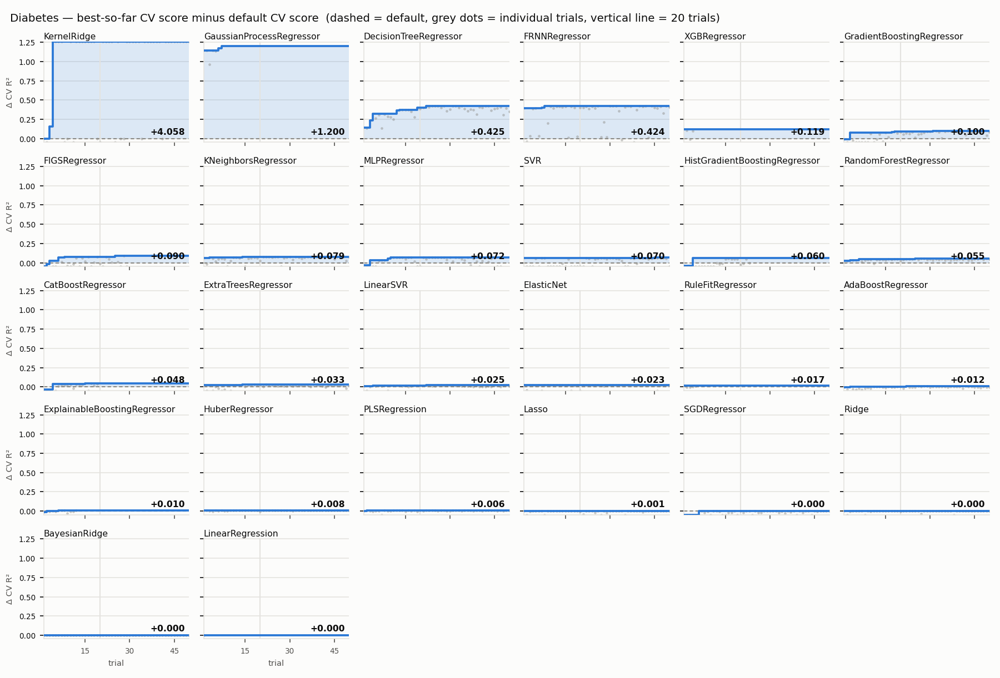

## Friedman1 (Regression) — R²

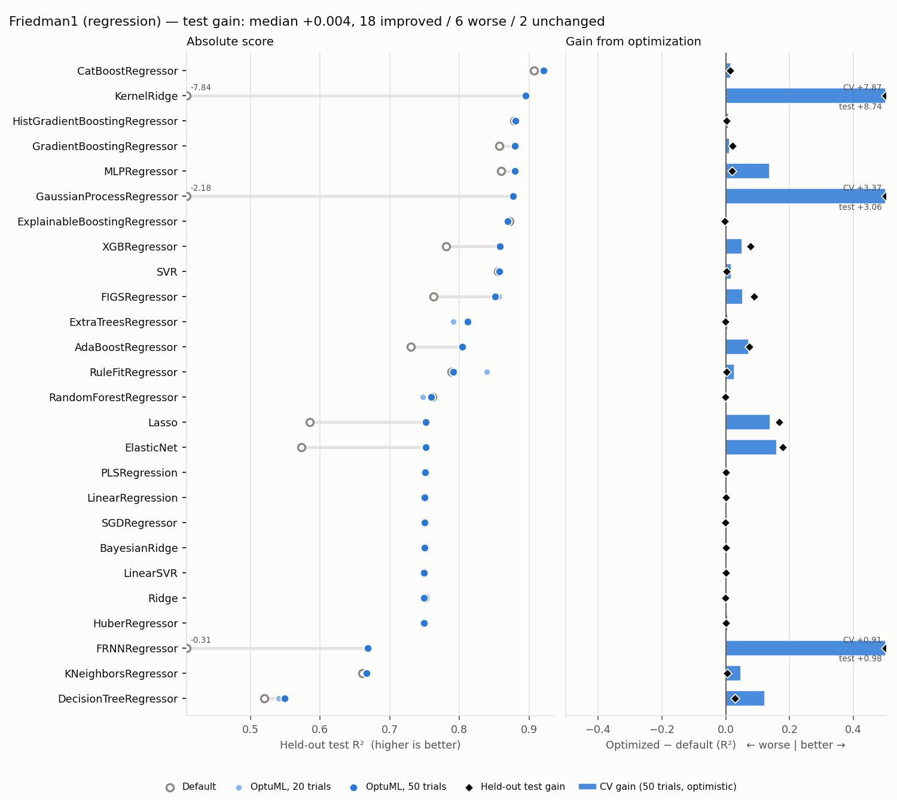

| Algorithm | Default CV | Default Test | Quick Test | Full CV | Full Test | ΔCV | ΔTest | 90% @ | Time (s) |
|-----------|:----------:|:------------:|:----------:|:-------:|:---------:|:---:|:-----:|:-----:|:--------:|
| CatBoostRegressor | 0.8901 | 0.9071 | 0.9210 | 0.9055 | 0.9210 | +0.0154 | +0.0139 | 9 | 132.4 |
| KernelRidge | -6.9909 | -7.8430 | 0.8950 | 0.8750 | 0.8950 | +7.8659 | +8.7380 | 3 | 17.7 |
| HistGradientBoostingRegressor | 0.8653 | 0.8789 | 0.8808 | 0.8731 | 0.8808 | +0.0078 | +0.0019 | 13 | 126.8 |
| GradientBoostingRegressor | 0.8575 | 0.8572 | 0.8813 | 0.8701 | 0.8795 | +0.0126 | +0.0223 | 16 | 88.4 |
| MLPRegressor | 0.7629 | 0.8599 | 0.8794 | 0.9004 | 0.8794 | +0.1375 | +0.0195 | 11 | 132.8 |
| GaussianProcessRegressor | -2.5239 | -2.1813 | 0.8772 | 0.8495 | 0.8772 | +3.3734 | +3.0585 | 1 | 128.2 |
| ExplainableBoostingRegressor | 0.8644 | 0.8721 | 0.8693 | 0.8678 | 0.8693 | +0.0034 | -0.0028 | 6 | 131.4 |
| XGBRegressor | 0.8004 | 0.7807 | 0.8580 | 0.8514 | 0.8580 | +0.0510 | +0.0773 | 1 | 557.0 |
| SVR | 0.8151 | 0.8558 | 0.8577 | 0.8328 | 0.8577 | +0.0177 | +0.0020 | 9 | 16.6 |
| FIGSRegressor | 0.7718 | 0.7632 | 0.8561 | 0.8249 | 0.8513 | +0.0531 | +0.0881 | 32 | 65.3 |
| ExtraTreesRegressor | 0.8200 | 0.8122 | 0.7911 | 0.8263 | 0.8115 | +0.0063 | -0.0007 | 37 | 24.6 |
| AdaBoostRegressor | 0.7383 | 0.7300 | 0.8031 | 0.8104 | 0.8043 | +0.0721 | +0.0742 | 22 | 63.8 |
| RuleFitRegressor | 0.7802 | 0.7889 | 0.8396 | 0.8067 | 0.7913 | +0.0264 | +0.0025 | 1 | 185.3 |
| RandomForestRegressor | 0.8029 | 0.7608 | 0.7477 | 0.8035 | 0.7591 | +0.0006 | -0.0017 | 46 | 42.7 |
| Lasso | 0.5848 | 0.5852 | 0.7519 | 0.7240 | 0.7519 | +0.1392 | +0.1666 | 1 | 6.5 |
| ElasticNet | 0.5645 | 0.5734 | 0.7504 | 0.7238 | 0.7514 | +0.1593 | +0.1780 | 1 | 6.7 |
| PLSRegression | 0.7218 | 0.7510 | 0.7510 | 0.7218 | 0.7510 | +0.0000 | +0.0000 | --- | 2.6 |
| LinearRegression | 0.7218 | 0.7498 | 0.7498 | 0.7218 | 0.7498 | +0.0000 | +0.0000 | --- | 0.0 |
| SGDRegressor | 0.7213 | 0.7499 | 0.7496 | 0.7253 | 0.7496 | +0.0040 | -0.0002 | 20 | 8.6 |
| BayesianRidge | 0.7220 | 0.7496 | 0.7496 | 0.7220 | 0.7496 | +0.0000 | -0.0000 | 14 | 2.7 |
| LinearSVR | 0.7238 | 0.7487 | 0.7507 | 0.7270 | 0.7494 | +0.0032 | +0.0007 | 34 | 9.9 |
| Ridge | 0.7218 | 0.7498 | 0.7493 | 0.7221 | 0.7492 | +0.0003 | -0.0005 | 4 | 5.2 |
| HuberRegressor | 0.7201 | 0.7491 | 0.7492 | 0.7257 | 0.7492 | +0.0056 | +0.0001 | 14 | 4.2 |
| FRNNRegressor | -0.2478 | -0.3110 | 0.6687 | 0.6582 | 0.6687 | +0.9061 | +0.9797 | 1 | 1.8 |
| KNeighborsRegressor | 0.6250 | 0.6610 | 0.6663 | 0.6730 | 0.6663 | +0.0480 | +0.0052 | 6 | 1.3 |
| DecisionTreeRegressor | 0.5389 | 0.5201 | 0.5403 | 0.6614 | 0.5490 | +0.1224 | +0.0289 | 12 | 4.5 |

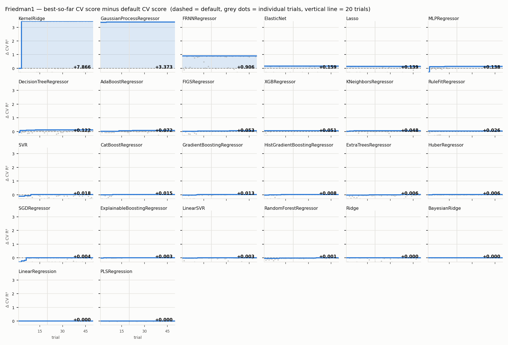

## Convergence across algorithms

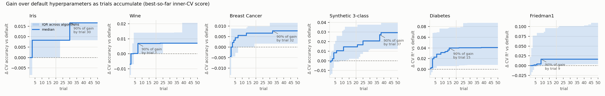

## Test gain heatmap

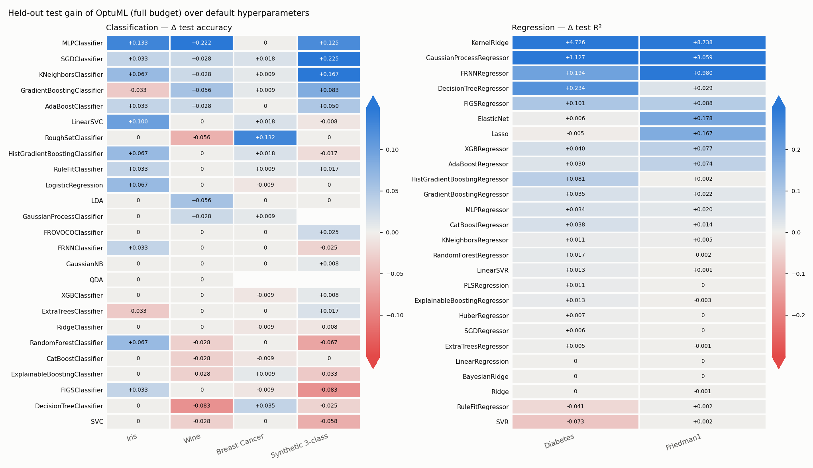
