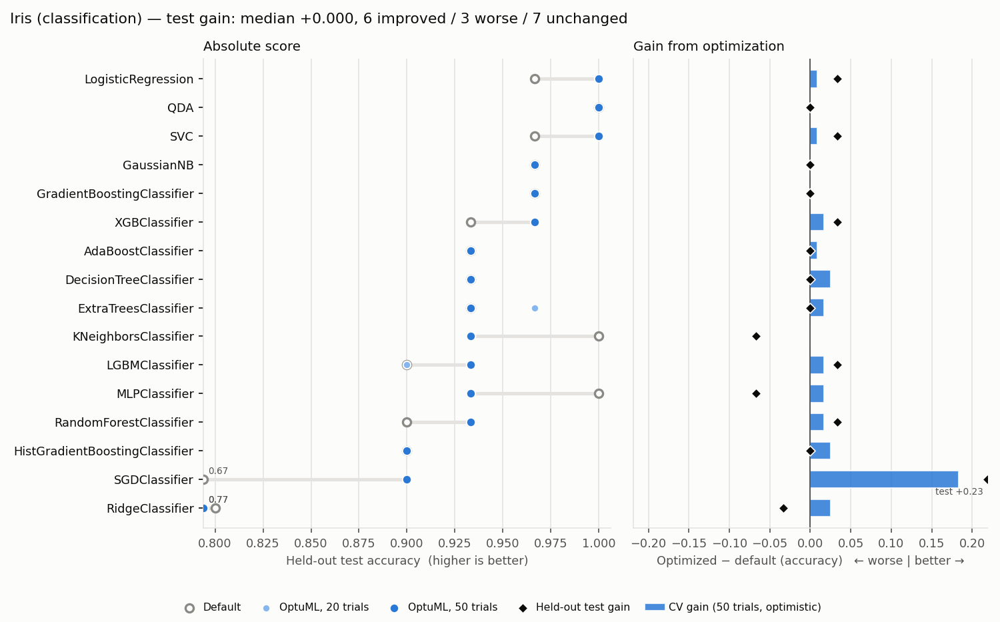
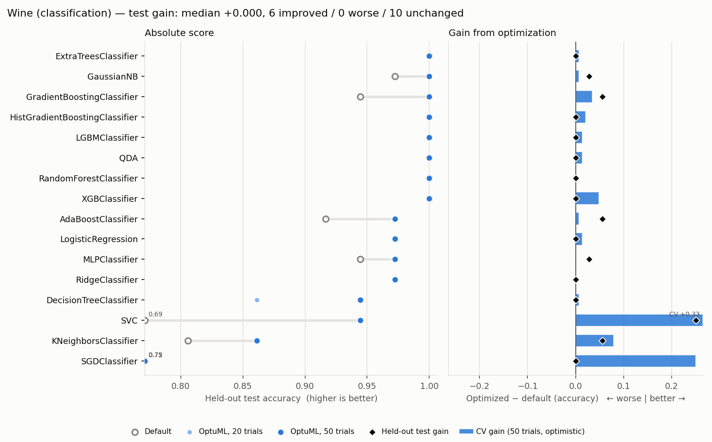
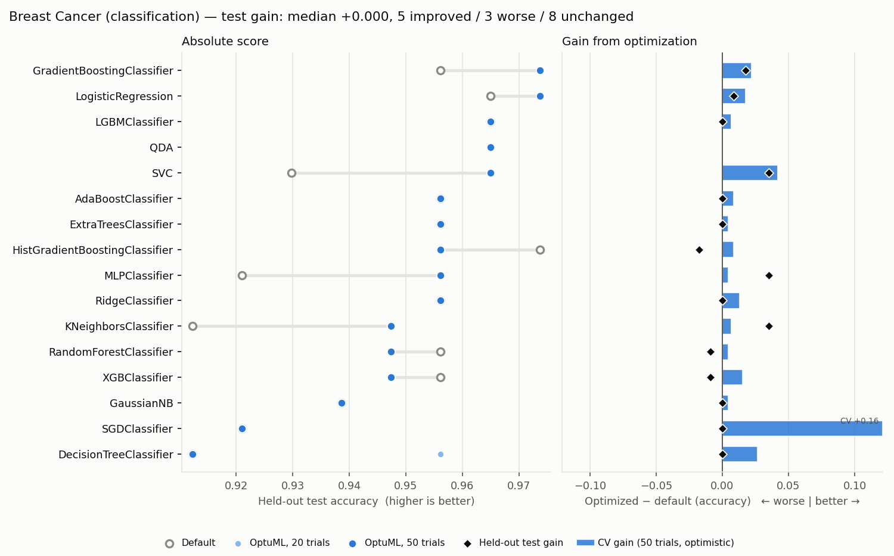
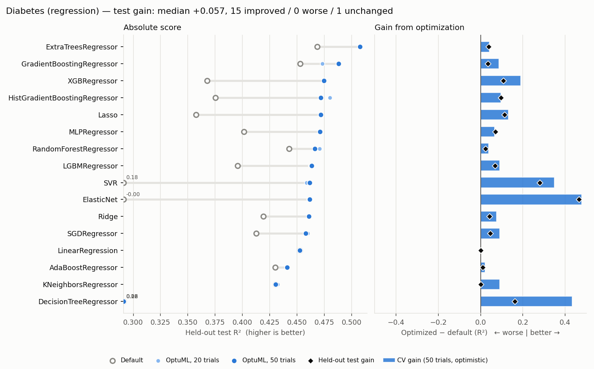
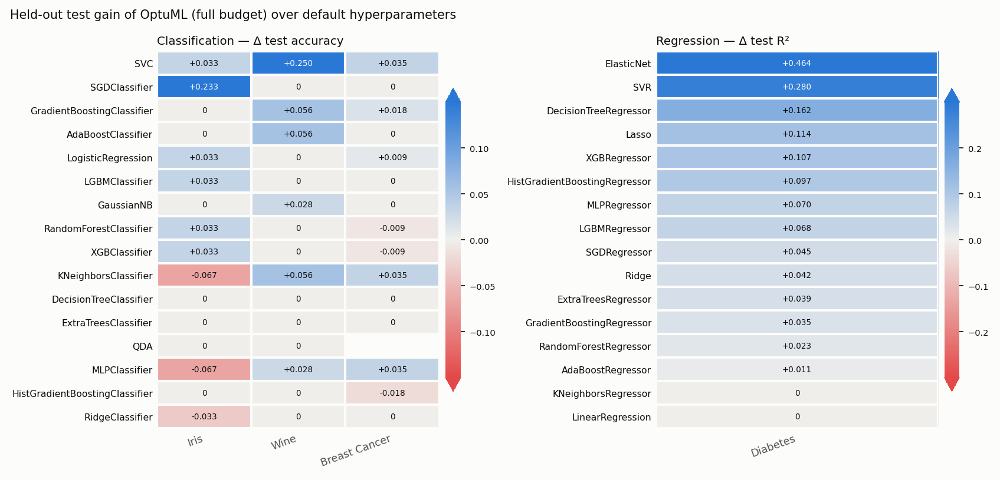

# OptuML Benchmark Results

Default scikit-learn hyperparameters vs. OptuML optimization (20 quick / 50 full trials).

- `CV` = mean inner cross-validation score on the training set (for OptuML this is the best trial, so it is optimistically biased); `Test` = score on the held-out test set.
- `ΔCV` / `ΔTest` = full-budget OptuML minus default (positive = optimization helped).
- `90% @` = trial at which the best-so-far CV score first reached 90% of its final gain.

## Summary

| Dataset | Task | Algorithms | Improved (test) | Worse (test) | Median ΔTest | Best default (test) | Best OptuML (test) |
|---------|------|:----------:|:---------------:|:------------:|:------------:|:-------------------:|:------------------:|
| Iris | classification | 16 | 6 | 3 | +0.0000 | 1.0000 (KNeighborsClassifier) | 1.0000 (SVC) |
| Wine | classification | 16 | 6 | 0 | +0.0000 | 1.0000 (RandomForestClassifier) | 1.0000 (RandomForestClassifier) |
| Breast Cancer | classification | 16 | 5 | 3 | +0.0000 | 0.9737 (HistGradientBoostingClassifier) | 0.9737 (GradientBoostingClassifier) |
| Diabetes | regression | 16 | 15 | 0 | +0.0567 | 0.4685 (ExtraTreesRegressor) | 0.5076 (ExtraTreesRegressor) |

## Iris (Classification) — accuracy

| Algorithm | Default CV | Default Test | Quick Test | Full CV | Full Test | ΔCV | ΔTest | 90% @ | Time (s) |
|-----------|:----------:|:------------:|:----------:|:-------:|:---------:|:---:|:-----:|:-----:|:--------:|
| SVC | 0.9750 | 0.9667 | 1.0000 | 0.9833 | 1.0000 | +0.0083 | +0.0333 | --- | 1.8 |
| LogisticRegression | 0.9667 | 0.9667 | 1.0000 | 0.9750 | 1.0000 | +0.0083 | +0.0333 | --- | 2.7 |
| QDA | 0.9750 | 1.0000 | 1.0000 | 0.9750 | 1.0000 | +0.0000 | +0.0000 | --- | 0.5 |
| GradientBoostingClassifier | 0.9667 | 0.9667 | 0.9667 | 0.9667 | 0.9667 | +0.0000 | +0.0000 | --- | 101.2 |
| GaussianNB | 0.9583 | 0.9667 | 0.9667 | 0.9583 | 0.9667 | +0.0000 | +0.0000 | --- | 0.6 |
| XGBClassifier | 0.9500 | 0.9333 | 0.9667 | 0.9667 | 0.9667 | +0.0167 | +0.0333 | --- | 85.0 |
| KNeighborsClassifier | 0.9750 | 1.0000 | 0.9333 | 0.9750 | 0.9333 | +0.0000 | -0.0667 | --- | 0.7 |
| RandomForestClassifier | 0.9500 | 0.9000 | 0.9333 | 0.9667 | 0.9333 | +0.0167 | +0.0333 | --- | 32.5 |
| ExtraTreesClassifier | 0.9583 | 0.9333 | 0.9667 | 0.9750 | 0.9333 | +0.0167 | +0.0000 | --- | 19.1 |
| AdaBoostClassifier | 0.9500 | 0.9333 | 0.9333 | 0.9583 | 0.9333 | +0.0083 | +0.0000 | --- | 35.2 |
| DecisionTreeClassifier | 0.9417 | 0.9333 | 0.9333 | 0.9667 | 0.9333 | +0.0250 | +0.0000 | --- | 0.7 |
| MLPClassifier | 0.9667 | 1.0000 | 0.9333 | 0.9833 | 0.9333 | +0.0167 | -0.0667 | --- | 47.2 |
| LGBMClassifier | 0.9583 | 0.9000 | 0.9000 | 0.9750 | 0.9333 | +0.0167 | +0.0333 | --- | 7.8 |
| HistGradientBoostingClassifier | 0.9417 | 0.9000 | 0.9000 | 0.9667 | 0.9000 | +0.0250 | +0.0000 | --- | 49.3 |
| SGDClassifier | 0.7833 | 0.6667 | 0.9000 | 0.9667 | 0.9000 | +0.1833 | +0.2333 | --- | 1.2 |
| RidgeClassifier | 0.8583 | 0.8000 | 0.7667 | 0.8833 | 0.7667 | +0.0250 | -0.0333 | --- | 0.8 |

## Wine (Classification) — accuracy

| Algorithm | Default CV | Default Test | Quick Test | Full CV | Full Test | ΔCV | ΔTest | 90% @ | Time (s) |
|-----------|:----------:|:------------:|:----------:|:-------:|:---------:|:---:|:-----:|:-----:|:--------:|
| RandomForestClassifier | 0.9862 | 1.0000 | 1.0000 | 0.9862 | 1.0000 | +0.0000 | +0.0000 | --- | 28.4 |
| ExtraTreesClassifier | 0.9791 | 1.0000 | 1.0000 | 0.9862 | 1.0000 | +0.0071 | +0.0000 | --- | 26.6 |
| GradientBoostingClassifier | 0.9584 | 0.9444 | 1.0000 | 0.9931 | 1.0000 | +0.0347 | +0.0556 | --- | 103.4 |
| HistGradientBoostingClassifier | 0.9581 | 1.0000 | 1.0000 | 0.9791 | 1.0000 | +0.0209 | +0.0000 | --- | 49.9 |
| GaussianNB | 0.9719 | 0.9722 | 1.0000 | 0.9791 | 1.0000 | +0.0071 | +0.0278 | --- | 0.6 |
| QDA | 0.9788 | 1.0000 | 1.0000 | 0.9931 | 1.0000 | +0.0143 | +0.0000 | --- | 0.6 |
| XGBClassifier | 0.9443 | 1.0000 | 1.0000 | 0.9931 | 1.0000 | +0.0488 | +0.0000 | --- | 85.3 |
| LGBMClassifier | 0.9722 | 1.0000 | 1.0000 | 0.9862 | 1.0000 | +0.0140 | +0.0000 | --- | 12.2 |
| AdaBoostClassifier | 0.9648 | 0.9167 | 0.9722 | 0.9722 | 0.9722 | +0.0074 | +0.0556 | --- | 45.9 |
| LogisticRegression | 0.9581 | 0.9722 | 0.9722 | 0.9724 | 0.9722 | +0.0143 | +0.0000 | --- | 32.1 |
| RidgeClassifier | 0.9931 | 0.9722 | 0.9722 | 0.9931 | 0.9722 | +0.0000 | +0.0000 | --- | 0.8 |
| MLPClassifier | 0.9512 | 0.9444 | 0.9722 | 0.9512 | 0.9722 | +0.0000 | +0.0278 | --- | 91.2 |
| SVC | 0.6480 | 0.6944 | 0.9444 | 0.9793 | 0.9444 | +0.3313 | +0.2500 | --- | 58.3 |
| DecisionTreeClassifier | 0.9163 | 0.9444 | 0.8611 | 0.9232 | 0.9444 | +0.0069 | +0.0000 | --- | 0.8 |
| KNeighborsClassifier | 0.7108 | 0.8056 | 0.8611 | 0.7899 | 0.8611 | +0.0791 | +0.0556 | --- | 0.7 |
| SGDClassifier | 0.4980 | 0.7500 | 0.7222 | 0.7483 | 0.7500 | +0.2502 | +0.0000 | --- | 2.5 |

## Breast Cancer (Classification) — accuracy

| Algorithm | Default CV | Default Test | Quick Test | Full CV | Full Test | ΔCV | ΔTest | 90% @ | Time (s) |
|-----------|:----------:|:------------:|:----------:|:-------:|:---------:|:---:|:-----:|:-----:|:--------:|
| GradientBoostingClassifier | 0.9560 | 0.9561 | 0.9737 | 0.9780 | 0.9737 | +0.0220 | +0.0175 | --- | 107.6 |
| LogisticRegression | 0.9429 | 0.9649 | 0.9737 | 0.9604 | 0.9737 | +0.0176 | +0.0088 | --- | 28.6 |
| SVC | 0.9099 | 0.9298 | 0.9649 | 0.9516 | 0.9649 | +0.0418 | +0.0351 | --- | 171.5 |
| QDA | --- | --- | 0.9649 | 0.9582 | 0.9649 | --- | --- | --- | 0.6 |
| LGBMClassifier | 0.9714 | 0.9649 | 0.9649 | 0.9780 | 0.9649 | +0.0066 | +0.0000 | --- | 9.0 |
| ExtraTreesClassifier | 0.9714 | 0.9561 | 0.9561 | 0.9758 | 0.9561 | +0.0044 | +0.0000 | --- | 27.4 |
| AdaBoostClassifier | 0.9692 | 0.9561 | 0.9561 | 0.9780 | 0.9561 | +0.0088 | +0.0000 | --- | 70.2 |
| HistGradientBoostingClassifier | 0.9714 | 0.9737 | 0.9561 | 0.9802 | 0.9561 | +0.0088 | -0.0175 | --- | 44.5 |
| RidgeClassifier | 0.9538 | 0.9561 | 0.9561 | 0.9670 | 0.9561 | +0.0132 | +0.0000 | --- | 0.8 |
| MLPClassifier | 0.9407 | 0.9211 | 0.9561 | 0.9451 | 0.9561 | +0.0044 | +0.0351 | --- | 129.6 |
| KNeighborsClassifier | 0.9363 | 0.9123 | 0.9474 | 0.9429 | 0.9474 | +0.0066 | +0.0351 | --- | 0.9 |
| RandomForestClassifier | 0.9538 | 0.9561 | 0.9474 | 0.9582 | 0.9474 | +0.0044 | -0.0088 | --- | 37.7 |
| XGBClassifier | 0.9626 | 0.9561 | 0.9474 | 0.9780 | 0.9474 | +0.0154 | -0.0088 | --- | 38.6 |
| GaussianNB | 0.9363 | 0.9386 | 0.9386 | 0.9407 | 0.9386 | +0.0044 | +0.0000 | --- | 0.6 |
| SGDClassifier | 0.7626 | 0.9211 | 0.9211 | 0.9231 | 0.9211 | +0.1604 | +0.0000 | --- | 1.4 |
| DecisionTreeClassifier | 0.9099 | 0.9123 | 0.9561 | 0.9363 | 0.9123 | +0.0264 | +0.0000 | --- | 1.4 |

## Diabetes (Regression) — R²

| Algorithm | Default CV | Default Test | Quick Test | Full CV | Full Test | ΔCV | ΔTest | 90% @ | Time (s) |
|-----------|:----------:|:------------:|:----------:|:-------:|:---------:|:---:|:-----:|:-----:|:--------:|
| ExtraTreesRegressor | 0.4064 | 0.4685 | 0.5076 | 0.4492 | 0.5076 | +0.0428 | +0.0391 | --- | 17.5 |
| GradientBoostingRegressor | 0.3610 | 0.4529 | 0.4731 | 0.4472 | 0.4880 | +0.0862 | +0.0351 | --- | 47.1 |
| XGBRegressor | 0.2398 | 0.3675 | 0.4745 | 0.4290 | 0.4745 | +0.1892 | +0.1070 | --- | 94.5 |
| HistGradientBoostingRegressor | 0.3422 | 0.3752 | 0.4802 | 0.4393 | 0.4718 | +0.0972 | +0.0966 | --- | 38.7 |
| Lasso | 0.3238 | 0.3576 | 0.4712 | 0.4557 | 0.4716 | +0.1319 | +0.1140 | --- | 0.5 |
| MLPRegressor | 0.3862 | 0.4012 | 0.4710 | 0.4520 | 0.4710 | +0.0658 | +0.0698 | --- | 97.0 |
| RandomForestRegressor | 0.3909 | 0.4428 | 0.4706 | 0.4291 | 0.4663 | +0.0382 | +0.0234 | --- | 33.4 |
| LGBMRegressor | 0.3405 | 0.3954 | 0.4621 | 0.4310 | 0.4635 | +0.0905 | +0.0680 | --- | 9.8 |
| SVR | 0.1122 | 0.1821 | 0.4585 | 0.4605 | 0.4617 | +0.3483 | +0.2796 | --- | 1.4 |
| ElasticNet | -0.0216 | -0.0025 | 0.4607 | 0.4565 | 0.4615 | +0.4780 | +0.4639 | --- | 0.5 |
| Ridge | 0.3802 | 0.4192 | 0.4608 | 0.4565 | 0.4608 | +0.0762 | +0.0417 | --- | 0.5 |
| SGDRegressor | 0.3671 | 0.4126 | 0.4597 | 0.4585 | 0.4581 | +0.0913 | +0.0454 | --- | 3.6 |
| LinearRegression | 0.4493 | 0.4526 | 0.4526 | 0.4493 | 0.4526 | +0.0000 | +0.0000 | --- | 0.0 |
| AdaBoostRegressor | 0.4030 | 0.4301 | 0.4409 | 0.4240 | 0.4409 | +0.0209 | +0.0108 | --- | 48.6 |
| KNeighborsRegressor | 0.3172 | 0.4302 | 0.4320 | 0.4070 | 0.4303 | +0.0898 | +0.0001 | --- | 0.7 |
| DecisionTreeRegressor | -0.1328 | 0.0607 | 0.1769 | 0.3001 | 0.2227 | +0.4329 | +0.1620 | --- | 0.8 |

## Test gain heatmap

